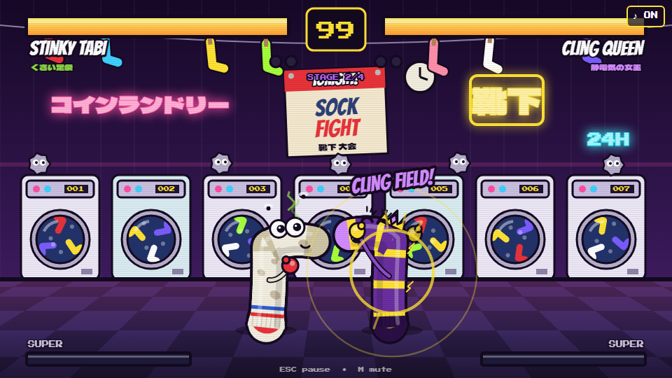

# Sock Fighters: Turbo Rinse

A cartoon sock fighting game in the style of 90s Japanese arcade fighters, in a single HTML file.
It has 17 fully voiced socks, a Japanese arcade announcer, four difficulty ladders, five arenas picked at random (Coin Laundry, Midnight Rooftop, Sunset Beach, Sakura Dojo, Inside the Dryer), a "?" Random pick on the select screen, and touch controls for phones.

**▶ Play it here: https://aligcoder.github.io/sock-fighters/**

## Play on a phone
Open the link above in Safari (iPhone) or Chrome (Android). Turn the phone sideways, and touch buttons appear automatically.
To get an app icon, tap **Share → Add to Home Screen**. The icon then opens the game full screen.

## Controls (keyboard)
| | Player 1 | Player 2 |
|---|---|---|
| Move / jump / crouch | W A S D | Arrow keys |
| Attack · Kick | Space · E | K · L |
| Special · Down + Special | F · S+F | ; · ↓+; |
| Super · Throw · Taunt | R · Q · T | ' · O · P |

**Kick combo:** land a kick, then tap Kick twice more for kick → spinning heel → SOCK-NADO! (hold down on any of them to finish with a sweep).

Esc pauses the game, M mutes the sound, V turns the announcer on or off, and N plays a voice test.

## Trophies, skins and unlockable heroes
- **29 trophies** on two pages (main menu → TROPHIES; ◀ ▶ to turn the page), from FIRST WASH to beating the story, a 10-hit combo, a comeback win, winning with every villain, and beating a random player in Quick Match. Clearing **Easy** unlocks the Lint Gang as playable heroes, **Hard** unlocks Steel Toe, King Knee-Sock and the Dryer Demon, and **Nightmare** unlocks Bleach Baron, Cling Queen and Iron Shogun.
- **Every hero has their own unique items**, nothing shared: 2 hero skins (e.g. Stinky's TOXIC WASTE and GYM GOLD) and 2 accessories (Stinky's pine air freshener and gym towel, Gran's pearl necklace and knitting yarn, the Demon's devil tail and bat wings, Baby Bootie's ducky bib and balloon…), each in any colour. Cling Queen has a whole royal wardrobe: feather boa, lily parasol, fancy cape, sorceress cape, Victorian capelet, fancy sceptre, the biggest fancy hat and a grand crown (capes replace her own cape, hats replace her lily crown). Unlock them by fighting with that hero: **3 wins** → skin 1, **8 wins** → accessory 1, **clear a ladder or story chapter** with them → skin 2, **15 wins or beat the whole story** with them → accessory 2. No two heroes share a hat, skin or accessory.
- **The Dryer:** on the character select screen, tap **DRYER: STYLE IT** (or press **C**). Your sock hops into the dryer, where you pick a skin, tune the colour, vividness and brightness, and put on the hero's accessory in any colour. Save it as **MY STYLE**.
- Progress is saved on your device. Online, your friend sees your custom style too.

## Story mode: *Lost in the Spin Cycle*
Main menu → **STORY MODE**. Queen Nylonia of the Hosiery (a two-legged pantyhose people from the Island of Nylonia) appears in Dryer No. 7 and asks for a hero to stop the Dryer Demon. You pick your hero on a big hero select screen, jump through the dryer portal, and fight from the Queen's palace.
- Each chapter is a run of normal fights with story scenes in between. Lose a fight and it's **MISSION FAILED**: try again, or go back to the palace. **Chapter 1, The Lint Plains** (Lint Bunny, Socklet, boss Holey Moley) and **Chapter 2, The Static Swamp** (a static-scrambled Mecha-Sock, Toe-Shinobi, boss Cling Queen) are followed by **Chapter 3, The Bleach Badlands**, **Chapter 4, The Ironing Fortress** and **Chapter 5, The Tumble Throne** (where MISMATCH, the Odd-Sock Golem stitched from a hundred stolen socks, guards the way to the Demon), with end credits and a palace ball. Then the story carries on: **Chapter 6, The Puppet Theatre** (socks on puppet strings, and the flamboyant sock puppet PRINCE PUPPETINI, who insists there is NO hand inside) and **Chapter 7, The Mitten Peaks** (a frozen mountain of lost gloves, and THE GRAND MITTEN, jealous that nobody ever says "lucky mitten"). Then comes **THE SHOE WARS**, chapters 8 to 20: the shoes rise up, led by the mysterious **BIG BOOT**. Nine new villains (Captain Flip-Flop, Lady Stiletto, Galosh Grande, Rolla Disco, Mr. Tappington, Dino-Slipper Dot, the Shoelace Snake, Studs McGoal and the Big Boot himself), seven new arenas (the Catwalk, Puddle Park, the Roller Disco, the Bedroom of Doom, the Shoe Cupboard, the Muddy Pitch, the Sole Summit), a kidnapped Queen, a spy bird called Kevin and a twist at the very end. Each chapter opens when the one before is cleared; the palace shows them as picture squares, and **CLEAR STORY PROGRESS** (tap twice) locks them all again (your skins and trophies stay).
- **SKILL TREE**: story fights give XP. Each level is a skill point for STRIKE POWER, GUARD, STAMINA, SPEED and VITALITY, and for perks in three rows (SUPER STARTER, COMBO MASTER, IRON SOCK, WARM WASH, SECOND WIND, LAST STAND). **Charms** from the **BOUNTY BOARD** (optional fights against villains you have met, plus Dojo sparring with Argyle-san) are strong against certain villains. Later chapters have smarter villains, and bosses get ENRAGED at low health. None of this touches arcade or online fights.
- **The twist:** Cling Queen and King Knee-Sock were never really bad. The Dryer Demon shapeshifted into **Princess Baby Bootie** (who could say no to a baby in a tiara?) and **hypnotised** them with a spinning rattle into his minions, so he could march on Nylonia. Beat them and they snap out of it, and a sepia **FLASHBACK** shows how it happened. In fights, the Demon's second special is now **HYPNO SPIRAL**: a slow spinning spiral that leaves you hypnotised (dazed) for a moment.
- **Every line is spoken in Japanese** (the English shows on screen, like subtitles), each character in their own voice and with feeling: Baby Bootie sobs, the Demon roars, Queen Nylonia is elegant with a pinch of sass, and SPARKLE, the fight announcer, narrates. Your hero's lines are in your hero's voice. The voices download when you open story mode (from the voices/ folder); see [tools/story/README.md](tools/story/README.md).
- The whole story script is in [docs/adventure-mode.md](docs/adventure-mode.md).

## MY SOCK, the Sock Maker and Daily Challenges

- **MY SOCK** (the card next to RANDOM): press C to open **CUSTOM HERO** and design your own fighter: colours, 10 patterns, height, width, foot size, 9 eye styles, eye colour, 6 fighting styles and up to three items (head, face, body). Up to 6 designs are saved, and they work online too.
- **20 MY SOCK items**, each the reward for a trophy.
- **SOCK MAKER** (main menu) shows every skin, accessory and MY SOCK item as an icon, sorted by hero, and how to unlock it; its MY SOCK group holds your custom socks and the **CUSTOM HERO** button designs a new one.
- **DAILY CHALLENGES**: three new goals every day for story XP; finish all three to open the daily chest (skill points, more on streak days).

## Modes
- **Arcade:** pick Easy, Medium, Hard or **Nightmare**. Each ladder starts gentler and builds up to its final boss.
- **2 Players:** two players on one keyboard.
- **Online QUICK MATCH:** fight a random player from anywhere, with no code: tap ⚡ QUICK MATCH and you are paired with the next player who searches (players in a match are skipped; both must have the same version of the game).
- **Online with a friend:** fight a friend on another phone or computer. One player picks **Host** and shares the 4-letter room code (or taps **Send invite link**); the other picks **Join** and types the code, or just opens the link. The two players can't choose the same sock.
  It uses [PeerJS](https://peerjs.com) (MIT) to find each other. After that, the two devices connect directly and exchange only button presses. Both devices run the same fight in lockstep and check every second that they still match.

## How it was made
- Everything is in `index.html`. The graphics are drawn in code, the music and sound effects are synthesized live, and the voices are embedded as audio clips.
- Voices: original voices designed from written descriptions with [Qwen3-TTS](https://github.com/QwenLM/Qwen3-TTS) (Apache-2.0). They are not modelled on any real performer. The first announcer prototype used [Kokoro-82M](https://huggingface.co/hexgrad/Kokoro-82M) (Apache-2.0).
- `tools/announcer`: scripts to design, record and embed the voices.
- `tools/rewrite`: a replay checker and balance tests, which measure human-vs-CPU fairness for every ladder stage.
- `Play on phone.bat`: shares the game on your home Wi-Fi from a Windows PC.
