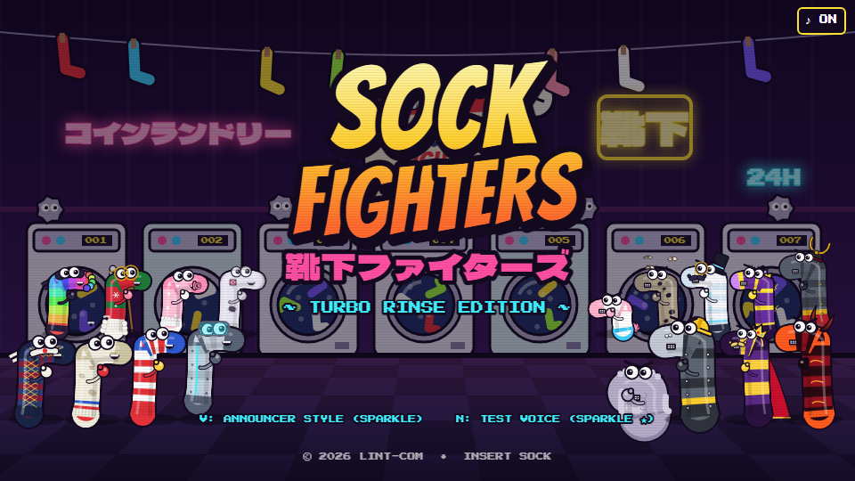

# Sock Fighters: Turbo Rinse

A cartoon sock fighting game in the style of 90s Japanese arcade fighters, in a single HTML file.
It has 17 fully voiced socks, a Japanese arcade announcer, four difficulty ladders, five arenas picked at random (Coin Laundry, Midnight Rooftop, Sunset Beach, Sakura Dojo, Inside the Dryer), a "?" Random pick on the select screen, and touch controls for phones.

**▶ Play it here: https://aligcoder.github.io/sock-fighters/**

## Play on a phone
Open the link above in Safari (iPhone) or Chrome (Android). Turn the phone sideways, and touch buttons appear automatically.
To get an app icon, tap **Share → Add to Home Screen**. The icon then opens the game full screen.

## Controls (keyboard)
| | Player 1 | Player 2 |
|---|---|---|
| Move / jump / crouch | W A S D | Arrow keys |
| Attack · Kick | Space · E | K · L |
| Special · Down + Special | F · S+F | ; · ↓+; |
| Super · Throw · Taunt | R · Q · T | ' · O · P |

**Kick combo:** land a kick, then tap Kick twice more for kick → spinning heel → SOCK-NADO! (hold down on any of them to finish with a sweep).

Esc pauses the game, M mutes the sound, V turns the announcer on or off, and N plays a voice test.

## Trophies, skins and unlockable heroes
- **16 trophies** (main menu → TROPHIES). Clearing **Easy** unlocks the Lint Gang as playable heroes, **Hard** unlocks Steel Toe, King Knee-Sock and the Dryer Demon, and **Nightmare** unlocks Bleach Baron, Cling Queen and Iron Shogun.
- **Every hero has their own unique items**, nothing shared: 2 hero skins (e.g. Stinky's TOXIC WASTE and GYM GOLD) and 1 accessory (Stinky's pine air freshener, Argyle's katana, Gran's pearl necklace, the Demon's devil tail…). Unlock them by fighting with that hero: **3 wins** → skin 1, **8 wins** → accessory, **clear a ladder or story chapter** with them → skin 2. No two heroes share a hat, skin or accessory.
- **The Dryer:** on the character select screen, tap **DRYER: STYLE IT** (or press **C**). Your sock hops into the dryer, where you pick a skin, tune the colour, vividness and brightness, and put on the hero's accessory in any colour. Save it as **MY STYLE**.
- Progress is saved on your device. Online, your friend sees your custom style too.

## Adventure mode: *Lost in the Spin Cycle*
Main menu → **ADVENTURE**. Queen Nylonia of the Hosiery (a two-legged pantyhose people from the Island of Nylonia) appears in Dryer No. 7 and asks for a hero to stop the Dryer Demon. You pick your hero on a big hero select screen, jump through the dryer portal, and fight from the Queen's palace.
- Each chapter is a run of normal fights with story scenes in between. **Chapter 1, The Lint Plains** (Lint Bunny, Socklet, boss Holey Moley) and **Chapter 2, The Static Swamp** (a static-scrambled Mecha-Sock, Toe-Shinobi, boss Cling Queen) are playable; each chapter opens when the one before is cleared. Chapters 3–5 are coming.
- The whole story script is in [docs/adventure-mode.md](docs/adventure-mode.md).

## Modes
- **Arcade:** pick Easy, Medium, Hard or **Nightmare**. Each ladder starts gentler and builds up to its final boss.
- **2 Players:** two players on one keyboard.
- **Online:** fight a friend on another phone or computer. One player picks **Host** and shares the 4-letter room code (or taps **Send invite link**); the other picks **Join** and types the code, or just opens the link. The two players can't choose the same sock.
  It uses [PeerJS](https://peerjs.com) (MIT) to find each other. After that, the two devices connect directly and exchange only button presses. Both devices run the same fight in lockstep and check every second that they still match.

## How it was made
- Everything is in `index.html`. The graphics are drawn in code, the music and sound effects are synthesized live, and the voices are embedded as audio clips.
- Voices: original voices designed from written descriptions with [Qwen3-TTS](https://github.com/QwenLM/Qwen3-TTS) (Apache-2.0). They are not modelled on any real performer. The first announcer prototype used [Kokoro-82M](https://huggingface.co/hexgrad/Kokoro-82M) (Apache-2.0).
- `tools/announcer`: scripts to design, record and embed the voices.
- `tools/rewrite`: a replay checker and balance tests, which measure human-vs-CPU fairness for every ladder stage.
- `Play on phone.bat`: shares the game on your home Wi-Fi from a Windows PC.
